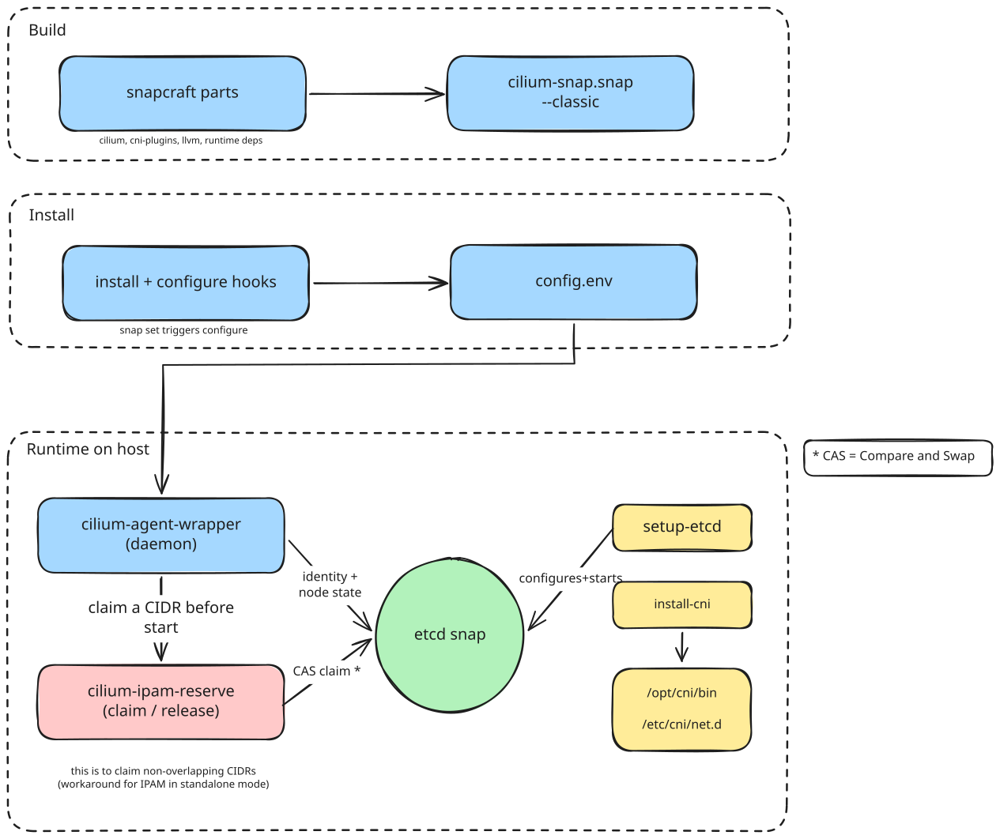

# Architecture

cilium-snap packages Cilium's agent to run on a single host with no
Kubernetes apiserver.

The editable source for this diagram is
[cilium-snap-architecture.excalidraw](cilium-snap-architecture.excalidraw),
open it at [excalidraw.com](https://excalidraw.com).

## Why no apiserver

Under Kubernetes, Cilium gets identity allocation, policy distribution and
load-balancer state from apiserver-registered CRDs. Without an apiserver
the agent needs a kvstore instead. This is not optional: leaving --kvstore
unset silently switches identity-allocation-mode to crd, which then blocks
forever waiting for an apiserver that does not exist.

This snap closes that gap with the separately-installed
[etcd snap](https://snapcraft.io/etcd) as a hard runtime dependency,
configured through the setup-etcd command.

Which CRDs are and aren't replaced is covered in detail, with upstream
source evidence, in findings/crd-replacement.md (an agent-summarised
research doc, see findings.md). Short version: identity allocation and
node state move to etcd. Network policy distribution and load-balancer
state have no delivery mechanism in this snap yet.

## Build time

snapcraft.yaml builds these parts, in order:

- **build-deps**: Go toolchain and C build tooling shared by the component
  builds.
- **cilium**: builds cilium-agent, cilium-dbg, hubble, the CNI plugin, and
  the eBPF datapath C sources from build-scripts/components/cilium
  (pinned v1.20.0).
- **cni-plugins**: builds the reference CNI plugins (loopback, portmap,
  host-local), pinned v1.9.1.
- **llvm**: stages clang-18 and llvm-18. This is a runtime dependency, not
  just a build one: the agent shells out to clang to compile datapath
  templates while running.
- **runtime-deps**: stages iproute2, iptables, ipset, kmod, bpftool, and
  etcd-client (etcdctl, used only by cilium-ipam-reserve, not the etcd
  server).
- **wrappers**: dumps snap/local/ into the snap payload.

Each component in build-scripts/components/ has a repository URL, a
pinned version (tag or full commit SHA), and a build.sh. build-component.sh
clones the pin and runs the build script.

Confinement is classic: the agent mounts bpffs and cgroup2, attaches tc
and XDP programs, drives netlink and iptables, and writes CNI files to the
host. None of that works under strict confinement.

## Apps

- **cilium-agent**: daemon, runs bin/cilium-agent-wrapper.
- **cilium-dbg**, **hubble**: debug and observability CLIs.
- **install-cni**, **setup-etcd**: one-shot commands.

cilium-ipam-reserve is an internal helper, not a declared app.

## Lifecycle hooks

- **install** (once): creates the state and lib directories.
- **configure** (on install and every `snap set`): reads each config key
  through snapctl, falling back to defaults.env, and renders
  $SNAP_DATA/config.env. Restarts cilium-agent only if the rendered file
  changed and the service is already running.
- **remove** (once): deletes the host-installed CNI files and releases
  this node's IPAM claim from etcd, best effort.

## Agent startup sequence

cilium-agent-wrapper is the daemon's actual entrypoint. On every start it:

1. Sources defaults.env, then config.env.
2. Creates the state, lib and run directories.
3. Mounts bpffs and cgroup2 if not already mounted.
4. Refreshes the eBPF datapath sources into a writable directory (the
   agent compiles them at runtime, so lib-dir must be writable).
5. Polls the configured etcd endpoint until it answers.
6. Calls cilium-ipam-reserve to claim this node's pod CIDR in etcd.
7. Auto-detects the egress interface if none is configured.
8. Builds the flag set and execs cilium-agent.

--kvstore=etcd and --identity-allocation-mode=kvstore are hard-coded,
never exposed as a config key, because of the apiserver-fallback failure
mode above.

## IPAM collision guard

cluster-pool IPAM normally gets non-overlapping per-node CIDRs from
cilium-operator, which this snap does not ship. Instead each host's admin
sets its pod range by hand. Nothing upstream checks that choice against
other nodes sharing the same etcd, so two overlapping ranges could make
auto-direct-node-routes install routes that steer one node's pod traffic
at another node's pods.

cilium-ipam-reserve closes that gap. Before every agent start, and on
clean removal, it:

1. Takes an etcd lock so two agents starting at once cannot both claim
   overlapping ranges.
2. Scans other nodes' claims and checks for CIDR overlap.
3. Refuses to start on any collision with a different node's claim.
4. On removal, releases the claim so another node can reuse the range.

Claims are not lease-bound: a node that disappears without a clean
removal leaves its claim in etcd until an operator clears it by hand.
This is deliberate, failing loudly beats silently expiring a claim.

## etcd and CNI setup

setup-etcd is a one-shot command, run once on the host that will serve
etcd. It renders the etcd snap's config file, enables periodic
compaction (the agent writes heartbeat keys continuously), and warns if
the bind address is not loopback-only (the config carries no TLS or
auth).

install-cni is a one-shot command that copies the Cilium CNI plugin and
the reference plugins onto the host, and writes the CNI conflist. There
is no kubelet here to do this, so the snap does it directly.

## Runtime directory layout

- $SNAP_DATA/config.env: rendered configuration.
- $SNAP_COMMON/cilium/state, $SNAP_COMMON/cilium/lib: agent state and lib
  dirs.
- /sys/fs/bpf, /run/cilium/cgroupv2: bpffs and cgroup2 mounts
  (configurable).
- /opt/cni/bin, /etc/cni/net.d: host CNI install target.
- /var/snap/etcd/common/etcd.conf.yml: etcd config, in the separate
  etcd snap's own data area.

See setup.md for installing, configuration.md for every tunable, and
testing.md for how this is verified.
