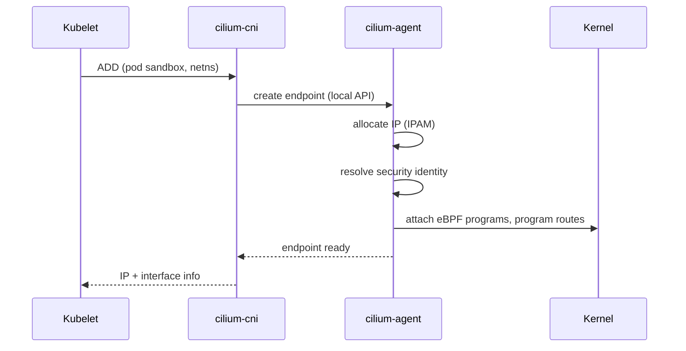
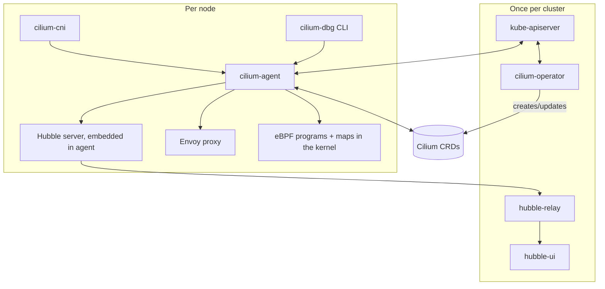
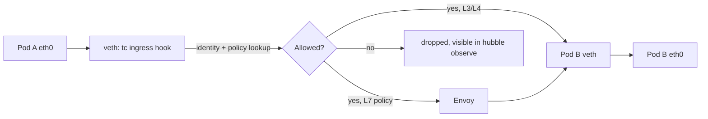

# Cilium Primer

> **This document was assembled by an AI coding assistant**, not written or
> independently verified line by line by a human reviewer. It is a background
> reference on upstream Cilium itself: what it is, how its pieces fit
> together, and how to poke at a running deployment. It is not about any
> particular packaging of Cilium. Every claim below is grounded in
> [docs.cilium.io](https://docs.cilium.io/en/stable/) (linked inline) or in
> Cilium's own command reference, and every example command and output shown
> is copied or adapted from those sources, not invented. Treat it as a map
> for orientation, not a substitute for the linked pages when you need exact
> flag semantics for your installed version, and not a substitute for
> actually running Cilium yourself. Reading this once does not make you
> proficient with Cilium. Building real, working knowledge still requires
> going through the official documentation and tutorials directly, running
> the commands in section 17 yourself, and breaking things on purpose in a
> disposable cluster until the behavior stops surprising you.

Read this top to bottom the first time. Each section builds on the one before
it. Skip around once you have the shape of the whole thing.

## 1. What Cilium is

Cilium is a networking and security layer for container workloads, built on
top of a Linux kernel technology called eBPF. On Kubernetes it acts as a CNI
(Container Network Interface) plugin: it gives every pod an IP address, routes
traffic between pods, load-balances Service traffic, and enforces network
policy, all without iptables as the primary mechanism.
([Introduction to Cilium & Hubble](https://docs.cilium.io/en/stable/overview/intro/))

The core idea that shapes everything else in this document: Cilium separates
*security* from *IP addressing*. A traditional firewall matches on source and
destination IP. Cilium matches on the *identity* of the workload that sent the
packet, derived from Kubernetes labels. Section 6 covers why this matters and
how it works. Keep it in mind, it explains a lot of design decisions you will
run into later (why there is a CiliumIdentity concept, why `hubble observe`
shows identities instead of just IPs, why policy survives pod restarts).

eBPF is what makes this possible. It lets Cilium load small, verified programs
directly into the Linux kernel's networking path, at the point a packet enters
or leaves a network interface, rather than reconfiguring userspace daemons or
rewriting thousands of iptables rules every time a pod starts or stops.
([Component Overview, eBPF section](https://docs.cilium.io/en/stable/overview/component-overview/#ebpf))

## 2. Where Cilium sits in Kubernetes networking

Kubernetes itself does not implement pod networking. It delegates that to
whatever CNI plugin is installed on each node. The contract is simple:
whenever `kubelet` starts or stops a pod, it calls a CNI plugin binary with an
`ADD` or `DEL` command and a bit of JSON. The plugin is responsible for:

1. Giving the pod's network namespace an interface and an IP address.
2. Making that IP address reachable from the rest of the cluster.
3. Tearing all of that down again when the pod is removed.

Cilium ships a CNI plugin binary, `cilium-cni`, that implements this contract.
It does not do the networking work itself. Instead, on `ADD`, it talks to the
local `cilium-agent` over a Unix domain socket and asks it to set up the
endpoint (allocate an IP, attach eBPF programs, wire up routes). The CNI
binary is a thin shim; the agent is where the real work happens.



This is why a Cilium node needs no `kube-proxy`-style separate component to get
a pod online: one agent process per node does IPAM, policy, and load balancing
all through the same eBPF programs.

## 3. eBPF in one page

eBPF (extended Berkeley Packet Filter) is a way to run small programs inside
the Linux kernel. Three properties matter for understanding Cilium:

1. **Verified.** The kernel runs every eBPF program through a verifier before
   loading it. The verifier rejects programs that could loop forever, read
   out of bounds, or crash the kernel. This is why Cilium can push new
   datapath logic without a kernel module and without a reboot.
2. **Attached at hooks.** A program does nothing by itself. It is attached to
   a hook point, a specific place in the kernel where the kernel will run it,
   such as "a packet arrived on this network interface" or "a TCP socket just
   became established."
3. **Backed by maps.** eBPF programs talk to userspace and to each other
   through BPF maps, which are typed key/value stores living in kernel memory
   (hash tables, arrays, LPM tries). Cilium's agent writes to these maps from
   userspace (policy decisions, service backends, identity mappings) and the
   in-kernel programs read them on every packet. This is the mechanism, not
   an afterthought: almost every `cilium-dbg bpf ...` subcommand in section 16
   is reading or writing one of these maps directly.

Cilium uses four kernel hook points, in increasing order of how much of the
network stack has already run by the time the program fires:

| Hook | Where it runs | What Cilium uses it for |
|---|---|---|
| XDP | Earliest point, in the network driver, before the kernel allocates an `sk_buff` | Fast drop of malicious or unexpected traffic, DDoS filtering, optional service acceleration |
| Traffic control (tc) ingress/egress | Attached to a network interface or a veth, after some stack processing but before L3 | The main workhorse: policy enforcement, identity lookup, redirecting traffic to the right endpoint |
| Socket operations | Attached to a cgroup, fires on TCP state transitions | Detects when a TCP connection reaches ESTABLISHED between two local endpoints |
| Socket send/recv | Fires on every send on a monitored TCP socket | Short-circuits local traffic straight to the peer socket, skipping the packet-level path entirely |

([eBPF Datapath Introduction](https://docs.cilium.io/en/stable/network/ebpf/intro/))

Every container's network namespace is connected to the host through a veth
(virtual ethernet) pair. One end lives inside the pod as `eth0`, the other
lives on the host, named something like `lxcXXXXXX`. Cilium attaches its tc
program to the host end of that pair. That single attachment point is enough
to see, and control, every packet entering or leaving the pod.

## 4. Cilium's moving parts

A full Cilium and Hubble deployment is made of these pieces. Not all of them
run on every node: agent and CNI run per node, the operator and Hubble Relay
run once (or a small replica count) per cluster.



- **cilium-agent**: the daemon. Runs on every node. Watches Kubernetes (or a
  key-value store, see section 5) for pods, policies, services, and nodes, and
  programs the eBPF datapath to match. This is the only component that is in
  the critical path for every packet.
- **cilium-operator**: handles cluster-wide bookkeeping that would be wasteful
  to do on every node: allocating per-node pod CIDRs in cluster-pool IPAM,
  creating the Cilium CRDs on startup (skippable with `--skip-crd-creation`),
  garbage-collecting stale identities, and keeping a kvstore heartbeat key
  fresh if a kvstore is in use. It is explicitly *not* in the critical path
  for forwarding or policy decisions: a cluster keeps working if the operator
  is briefly down, though IPAM for brand-new nodes and kvstore health checks
  degrade.
  ([Component Overview, Operator](https://docs.cilium.io/en/stable/overview/component-overview/#cilium))
- **cilium-cni**: the CNI plugin binary `kubelet` invokes. A thin shim over
  the agent's local API, described in section 2.
- **cilium-dbg**: the in-agent debug CLI. Talks to the *local* agent's REST
  API over a Unix socket. This is not the same tool as the `cilium` CLI
  described next, see section 15 for the distinction.
- **Hubble server**: embedded directly in `cilium-agent`, not a separate
  process. Exposes a gRPC API with flow data and Prometheus metrics, scoped to
  that one node.
- **hubble-relay**: a standalone deployment that connects to every node's
  Hubble server and presents one unified, cluster-wide gRPC API.
- **hubble (CLI)** and **hubble-ui**: clients. The CLI can talk to a local
  Hubble server or to Relay. The UI only talks to Relay.
- **Envoy**: Cilium's userspace L7 proxy. Only invoked for traffic that needs
  L7 inspection (HTTP, gRPC, Kafka, TLS SNI). L3/L4 traffic never touches it.

([Component Overview](https://docs.cilium.io/en/stable/overview/component-overview/))

## 5. The control plane: where Cilium gets its state from

The agent needs to know about pods, their labels, network policies, Services,
and other nodes. It gets this from a data store, and Cilium supports two:

1. **Kubernetes CRDs (default).** The agent watches Kubernetes custom
   resources directly through the apiserver, the same watch mechanism any
   Kubernetes controller uses.
2. **A key-value store (etcd).** Optional, used as a scalability optimization
   on very large clusters, because direct key-value watches generate less
   load than CRD watches at scale. It is possible to point this at a
   dedicated etcd cluster or at Kubernetes' own etcd.

([Component Overview, Data Store](https://docs.cilium.io/en/stable/overview/component-overview/#data-store))

For a cluster that already has a working Kubernetes apiserver, CRDs are the
default and the simplest path. The rest of this document assumes CRD mode
unless stated otherwise, since that is what you will see on any default
install.

## 6. Identity: security without IP addresses

This is the idea from section 1, spelled out properly, because the rest of
policy and observability only make sense once this clicks.

A traditional IP-based firewall rule looks like "allow traffic to
`10.1.1.2` only from `[10.1.2.2, 10.1.2.3, 20.4.9.1]`". Every time a pod with
a relevant label starts or stops, every node's firewall rules need updating.
In a cluster with high pod churn, that is a lot of continuous rewriting, and a
new pod cannot safely start until every other node has caught up.

Cilium instead assigns a cluster-wide numeric **security identity** to every
unique set of security-relevant labels. All pods sharing the same identity
relevant labels get the same identity, regardless of which node they land on
or how many of them exist. A policy rule like "role=frontend may talk to
role=backend" compiles down to "identity 5001 may talk to identity 5002",
and that mapping needs no updates as pods scale up or down, only when a
genuinely new label combination shows up for the first time.
([Identity-Based security](https://docs.cilium.io/en/stable/security/network/identity/))

A few concrete, useful facts about identities:

- Identity is a `uint32`. The minimum valid identity is `1`. **Identity `0`
  means "not found"**, not a real identity. If you see identity `0` in a
  `hubble observe` flow, that is a signal something failed to resolve, not a
  normal value.
- A fixed set of **reserved identities** exist for traffic that is not a
  regular Cilium-managed pod:

  | Identity | Numeric ID | Meaning |
  |---|---|---|
  | `reserved:unknown` | 0 | Could not be derived |
  | `reserved:host` | 1 | Traffic from/to the local host itself |
  | `reserved:world` | 2 | Anything outside the cluster |
  | `reserved:unmanaged` | 3 | A pod not managed by Cilium (started before Cilium was installed) |
  | `reserved:health` | 4 | Cilium's own health-check traffic |
  | `reserved:init` | 5 | Temporary identity while labels are still being resolved |
  | `reserved:remote-node` | 6 | Hosts in other nodes of the cluster (or a connected cluster) |
  | `reserved:kube-apiserver` | 7 | A node running the kube-apiserver |
  | `reserved:ingress` | 8 | Source address used by Ingress proxies |

  ([Terminology, Special Identities](https://docs.cilium.io/en/stable/gettingstarted/terminology/#special-identities))

- A handful of **well-known identities** (CoreDNS, kube-dns, cilium-operator)
  get a fixed numeric ID without needing to contact anything, so that DNS and
  bootstrapping traffic can be policy-enforced even before the rest of the
  cluster is up.
- Beyond the reserved range, identity numbers are partitioned by scope:
  cluster-local identities live in `256`-`65535`, identities for remote
  ClusterMesh clusters above that, and CIDR-based or remote-node identities
  (used when policy selects on raw IP ranges rather than labels) are
  deliberately node-local and start above `16,777,216`, specifically so they
  never collide with a real cluster-wide identity carried on the wire in a
  VXLAN or Geneve header.
  ([Security Identities internals](https://docs.cilium.io/en/stable/internals/security-identities/))

Identity allocation is itself a coordination problem: the first pod with a
given label set has to ask the control plane (CRD or kvstore) "has anyone seen
this label set before?" and either gets back an existing identity or causes a
new one to be minted. That round trip is why a pod briefly sits in a
`waiting-for-identity` state right after creation, covered properly in
section 16.

## 7. Custom Resource Definitions: Kubernetes as the control plane

When running on Kubernetes with the default CRD data store, Cilium extends the
Kubernetes API with its own resource types (`cilium.io/v2` and
`cilium.io/v2alpha1`). `cilium-operator` creates these on startup unless told
not to (`--skip-crd-creation`, used when a Helm chart or GitOps tool manages
CRD lifecycle separately). The ones worth knowing by name:

| CRD | Scope | What it represents |
|---|---|---|
| `CiliumNetworkPolicy` (CNP) | Namespaced | Cilium's extended policy format, L3 to L7, covered in section 13 |
| `CiliumClusterwideNetworkPolicy` (CCNP) | Cluster | Same rule language as CNP, but cluster-scoped and able to select nodes |
| `CiliumNode` | Cluster | Per-node state: allocated pod CIDR, health IPs, encryption keys, used heavily in cluster-pool IPAM (section 11) |
| `CiliumIdentity` | Cluster | One object per allocated security identity; the object's name *is* the numeric identity, its labels are the label set it represents |
| `CiliumEndpoint` | Namespaced | Auto-created by Cilium, one per pod it manages; carries that pod's identity, IP, and policy/health status |
| `CiliumEndpointSlice` | Cluster | Batches many CiliumEndpoints together to reduce apiserver watch load on large clusters |
| `CiliumCIDRGroup` | Cluster | A reusable, named set of CIDRs that policies can reference instead of repeating IP ranges |
| `CiliumLocalRedirectPolicy` | Namespaced | Redirects traffic destined elsewhere to a local backend on the same node |
| `CiliumEgressGatewayPolicy` | Cluster | Forces egress traffic from selected pods out through a chosen gateway node |
| `CiliumEnvoyConfig` / `CiliumClusterwideEnvoyConfig` | Namespaced / Cluster | Hand Cilium a raw Envoy xDS configuration for advanced L7 and Service Mesh use cases |
| `CiliumLoadBalancerIPPool` | Cluster | A pool of IPs Cilium can assign to `LoadBalancer`-type Services |
| `CiliumBGP*` family | Cluster | BGP peering and route advertisement configuration |
| `CiliumL2AnnouncementPolicy` | Cluster | ARP/NDP announcement for Service IPs on an L2 network, an alternative to BGP |
| `CiliumExternalWorkload` | Namespaced | Represents a non-Kubernetes workload (a VM) joined into the cluster's identity and policy model |

A pattern worth internalizing: most of these CRDs exist because Cilium needs
somewhere to store state that is bigger, more structured, or longer-lived than
what fits naturally in a pod annotation. `CiliumIdentity` and `CiliumEndpoint`
specifically are the Kubernetes-native equivalent of what a kvstore deployment
would instead keep as raw key-value pairs, same information, different
transport.

You will rarely create most of these by hand. `CiliumNetworkPolicy` and
`CiliumClusterwideNetworkPolicy` are the two you write yourself; the rest are
written by Cilium's own components (the agent writes `CiliumEndpoint`, the
operator writes and reconciles `CiliumNode`, `CiliumIdentity`, and the
BGP/LoadBalancer pool types).

A minimal `CiliumNetworkPolicy`, to make the shape concrete before section 13
goes deeper:

```yaml
apiVersion: cilium.io/v2
kind: CiliumNetworkPolicy
metadata:
  name: allow-frontend-to-backend
  namespace: default
spec:
  endpointSelector:
    matchLabels:
      role: backend
  ingress:
  - fromEndpoints:
    - matchLabels:
        role: frontend
    toPorts:
    - ports:
      - port: "8080"
        protocol: TCP
```

Under the hood, the raw Go type backing this is just metadata plus a `Spec` (a
single rule) or `Specs` (a list of rules), nothing more exotic than any other
CRD.
([CiliumNetworkPolicy reference](https://docs.cilium.io/en/stable/network/kubernetes/policy/#ciliumnetworkpolicy))

## 8. The eBPF datapath: the objects built from the hooks

Section 3 listed the raw kernel hooks. Cilium combines them with a few virtual
network interfaces (`cilium_host`, `cilium_net`, and, in overlay mode,
`cilium_vxlan`) and an Envoy instance to build a small number of logical
datapath objects. Think of these as the "stages" a packet can pass through:

- **Prefilter**: an XDP-based pass that drops obviously-invalid traffic
  (wrong destination) before it costs any more CPU.
- **Endpoint policy**: the core object. Looks up the packet's source identity
  and the destination endpoint's policy, and either drops it, forwards it to
  a local endpoint, hands it to the service object, or hands it to the L7
  policy object.
- **Service**: a map lookup on destination IP (and optionally port). A hit
  rewrites the packet to one of the Service's backend pods. This is the
  entire mechanism behind ClusterIP/NodePort load balancing, see section 12.
- **L3 encryption**: optional. Marks packets for IPsec or WireGuard
  encryption/decryption via the kernel's `xfrm` layer.
- **Socket layer enforcement**: the socket-hook pair from section 3. Once a
  TCP connection between two local endpoints (or an endpoint and a local
  proxy) is ESTABLISHED, further sends bypass the per-packet path entirely
  and go straight to the peer socket, after one validation that policy still
  permits it.
- **L7 policy**: hands matching traffic off to the embedded Envoy instance for
  HTTP, gRPC, Kafka, or TLS-SNI-level enforcement.

([eBPF Datapath Introduction](https://docs.cilium.io/en/stable/network/ebpf/intro/))

## 9. Life of a packet

Three concrete walk-throughs, because the abstract list above only clicks once
you trace an actual packet.

**Endpoint to endpoint (same node).** Pod A sends a packet to Pod B on the
same node. It leaves Pod A's `eth0`, crosses the veth pair, and hits the tc
ingress hook on the host side of that veth. The endpoint policy object looks
up Pod A's identity and Pod B's policy, decides to allow it, and redirects the
packet straight to Pod B's veth, no routing table lookup needed since Cilium
already knows exactly which local endpoint owns that destination IP. If an L7
policy applies, the packet is redirected to Envoy first; if socket layer
enforcement already fast-pathed this TCP connection, the per-packet hop is
skipped entirely after the handshake.

**Egress from an endpoint.** Pod A sends to something off this node. Same
veth-ingress hook, same identity/policy lookup, but this time the policy
object hands the packet to the Service object (if it targets a Service VIP)
and then out either the physical NIC (native routing) or the overlay
interface `cilium_vxlan` (encapsulation mode, see section 10). Optional L3
encryption happens just before the packet actually leaves the node.

**Ingress to an endpoint.** A packet arrives from the network, decrypts first
if encryption is on, then follows the same endpoint-policy lookup before being
redirected into the destination pod's veth.

([Life of a Packet](https://docs.cilium.io/en/stable/network/ebpf/lifeofapacket/))



The one lookup that appears in every single one of these paths is "what
identity does this source IP map to." That mapping lives in the **ipcache**,
an eBPF map keyed by IP, populated from CRDs (`CiliumEndpoint`, `CiliumNode`)
or kvstore state. `cilium-dbg bpf ipcache list` (section 16) dumps it
directly.

## 10. Routing modes: how packets actually cross nodes

Section 9 glossed over one detail: once a packet needs to leave the local
node, how does it actually reach the right node? Cilium supports two
fundamentally different approaches.

### Encapsulation (the default)

Every node forms a mesh of VXLAN (default, UDP port 8472) or Geneve (UDP port
6081) tunnels to every other node. All inter-node pod traffic is wrapped in a
UDP packet addressed node-to-node, carried over whatever network already
connects the nodes.

Advantages: works on almost any network, since the only requirement is that
nodes can reach each other over plain IP. The underlying network never needs
to know about pod IP ranges. New nodes joining the cluster are automatically
absorbed into the mesh.

Disadvantage: the tunnel header eats into the usable packet size (50 bytes of
overhead for VXLAN), lowering effective MTU unless jumbo frames are enabled.
([Routing, Encapsulation](https://docs.cilium.io/en/stable/network/concepts/routing/#encapsulation))

### Native routing

Set with `routing-mode: native`. Cilium stops encapsulating and hands
non-local packets to the normal Linux routing subsystem, exactly as if a
regular process on that host had sent them. This requires the underlying
network to actually know how to route pod IP ranges, which happens one of two
ways:

1. A router on the network already knows how to reach every pod CIDR (common
   in cloud environments, see the AWS ENI and GKE notes below).
2. Every node is taught every other node's pod CIDR directly. If all nodes
   share one L2 segment, `auto-direct-node-routes: true` does this
   automatically by inserting routes into each node's kernel routing table.
   Otherwise, something else (a BGP daemon, static routes) must distribute
   those routes.

Advantage: no encapsulation overhead, full MTU available, and native
visibility into the real source/destination IP on the wire. Disadvantage:
depends on the network actually being capable of carrying pod IPs, which is
not every network.
([Routing, Native-Routing](https://docs.cilium.io/en/stable/network/concepts/routing/#native-routing))

### Cloud-specific variants

On AWS, `ipam: eni` hands pods real VPC-routable IPs out of the node's Elastic
Network Interfaces, so pod traffic needs no SNAT inside the VPC. On GKE,
native routing plus Alias IP ranges gets the same effect using Google Cloud's
own routing. Both are native routing under the hood, just with the pod CIDR
already known to the surrounding cloud network instead of needing
`auto-direct-node-routes`.
([Routing, AWS ENI](https://docs.cilium.io/en/stable/network/concepts/routing/#aws-eni),
[Routing, Google Cloud](https://docs.cilium.io/en/stable/network/concepts/routing/#google-cloud))

## 11. IP address management (IPAM)

Before any of the routing above matters, a pod needs an IP in the first
place. Cilium supports several IPAM modes, chosen per cluster, not per pod:

| Mode | CIDR comes from | Typical use |
|---|---|---|
| Cluster Scope (default) | Cilium itself, via the `CiliumNode` CRD | Any cluster where Kubernetes isn't already handing out per-node PodCIDRs |
| Kubernetes Host Scope | Kubernetes' own `v1.Node.spec.podCIDR` | Clusters where `kube-controller-manager` already allocates per-node CIDRs |
| Multi-Pool | Cilium, with multiple pools and per-node/per-pool flexibility | Mixed CIDR sizes or multiple address pools per cluster |
| CRD-backed | An external controller writing to a CRD | Integrating with an external IPAM system |
| AWS ENI | AWS, via the EC2 API | Running on AWS with VPC-native pod IPs |
| Azure IPAM | Azure | Running on AKS with VNet-native pod IPs |
| GKE | Google Cloud, via Alias IP ranges | Running on GKE |

([IP Address Management overview](https://docs.cilium.io/en/stable/network/concepts/ipam/))

Cluster Scope (the default) is worth understanding in a bit more detail since
it is what most self-managed clusters end up running. `cilium-operator`
subdivides one or more configured pool CIDRs and writes a per-node slice into
each node's `CiliumNode.spec.ipam.podCIDRs`. The agent on that node waits at
startup until its own `CiliumNode` object carries a CIDR, then hands out
individual pod IPs from within it.
([Cluster Scope IPAM](https://docs.cilium.io/en/stable/network/concepts/ipam/cluster-pool/))

A sharp edge worth knowing up front: changing IPAM mode on a live cluster is
explicitly unsupported and can permanently break connectivity for existing
workloads. If you need a different mode, that is a new cluster, not a
reconfiguration, with the single exception of an online migration path from
cluster-pool to multi-pool.
([IPAM overview, migration note](https://docs.cilium.io/en/stable/network/concepts/ipam/))

## 12. Services and the kube-proxy replacement

Kubernetes Services (ClusterIP, NodePort, LoadBalancer) need something to
rewrite a virtual IP into one of the real backend pod IPs. The traditional
answer is `kube-proxy`, driven by iptables or IPVS. Cilium can fully replace
it using the same eBPF service maps already described in section 8's Service
object.

Two distinct mechanisms cover two distinct traffic directions:

- **East-west (pod to Service, inside the cluster)**: handled at the socket
  layer. When a pod calls `connect()` on a Service VIP, Cilium rewrites the
  destination *before* a packet is ever built, directly in the socket's
  connect call. This avoids per-packet NAT entirely for in-cluster traffic.
- **North-south (external traffic to a Service)**: handled per-packet, with
  support for XDP acceleration, Direct Server Return (DSR), and Maglev
  consistent hashing for backend selection.

([Introduction, Load Balancing](https://docs.cilium.io/en/stable/overview/intro/#load-balancing))

To validate the replacement is active, check `cilium-dbg status` (full field
guide in section 16):

```
$ cilium-dbg status | grep KubeProxyReplacement
KubeProxyReplacement:   True        [eth0 (Direct Routing), eth1]
```

And to see the actual service table Cilium is enforcing:

```
$ cilium-dbg service list
ID   Frontend               Service Type   Backend
4    10.104.239.135:80/TCP      ClusterIP      1 => 10.217.0.107:80/TCP
                                               2 => 10.217.0.149:80/TCP
5    0.0.0.0:31940/TCP          NodePort       1 => 10.217.0.107:80/TCP
                                               2 => 10.217.0.149:80/TCP
```

A useful cross-check when kube-proxy replacement is genuinely active:
`iptables-save | grep KUBE-SVC` should come back empty, since no iptables
rule for the Service should exist at all.
([Kubernetes Without kube-proxy](https://docs.cilium.io/en/stable/network/kubernetes/kubeproxy-free/))

## 13. Network policy

Three ways to define policy, all enforced by the same agent and the same
eBPF maps:

1. Standard Kubernetes `NetworkPolicy`, L3/L4 only, distributed automatically
   by Kubernetes to every node.
2. `CiliumNetworkPolicy` / `CiliumClusterwideNetworkPolicy`, Cilium's own CRD
   format (introduced in section 7), which adds L7 rules, DNS-based rules,
   entity-based rules (`host`, `world`, `cluster`, `init`), and node
   selectors on top of what plain `NetworkPolicy` can express.

Both are watched through the normal Kubernetes CRD/API mechanism, which is
why Kubernetes automatically gets these rules to every agent with no extra
distribution step needed.
([Overview of Network Policy](https://docs.cilium.io/en/stable/security/policy/))

A worked L7 example, restricting an HTTP endpoint rather than just a port:

```yaml
apiVersion: cilium.io/v2
kind: CiliumNetworkPolicy
metadata:
  name: allow-get-public
  namespace: default
spec:
  endpointSelector:
    matchLabels:
      app: api
  ingress:
  - fromEndpoints:
    - matchLabels:
        role: frontend
    toPorts:
    - ports:
      - port: "80"
        protocol: TCP
      rules:
        http:
        - method: "GET"
          path: "/public/.*"
```

Without any policy at all selecting a given endpoint, Cilium's default is to
allow all traffic to and from it (same posture as plain Kubernetes). The
moment a single policy selects an endpoint on ingress (or egress), that
direction switches to default-deny for that endpoint, and only explicitly
allowed traffic passes. This default-deny-on-first-rule behavior is the one
most beginners get surprised by: adding one narrow allow rule can silently
block traffic you didn't think you were touching, if that traffic hits the
same endpoint on the same direction.
([Policy Enforcement Modes](https://docs.cilium.io/en/stable/security/policy/intro/))

## 14. Observability with Hubble

Hubble reuses the same eBPF visibility Cilium already has for enforcement, so
enabling observability costs no extra agents and no extra packet capture
mechanism. It answers questions like: which pods are talking to which, is any
traffic being dropped and why, and what is the L7 (HTTP/gRPC/DNS) behavior
between two services.
([Introduction to Hubble](https://docs.cilium.io/en/stable/overview/intro/#what-is-hubble))

Scope matters here. By default, each node's Hubble server only sees that
node's own traffic. `hubble-relay` is what turns per-node visibility into
cluster-wide visibility, by fanning a single query out to every node's Hubble
server and merging the results.
([Network Observability with Hubble](https://docs.cilium.io/en/stable/observability/hubble/))

Practical commands, roughly in order of how you'd actually use them:

```
# Is the local Hubble server even healthy?
$ hubble status
Healthcheck (via unix:///var/run/cilium/hubble.sock): Ok
Current/Max Flows: 4095/4095 (100.00%)
Flows/s: 164.21

# Watch everything involving one pod, last 3 minutes
$ hubble observe --since 3m --pod default/tiefighter

# Through Relay, cluster-wide, after port-forwarding it locally
$ hubble status -P
$ hubble observe -P
```

A `hubble observe` line looks like:

```
May  4 12:47:08.811: default/tiefighter:53875 -> kube-system/coredns-...:53 to-endpoint FORWARDED (UDP)
```

Read it left to right: timestamp, source namespace/pod:port, direction arrow,
destination namespace/pod:port, a short description of which datapath stage
produced the verdict, the verdict itself (`FORWARDED` or `DROPPED`), and the
L4 protocol or TCP flags. `DROPPED` lines are the ones worth reading closely,
they are the direct, real-time evidence of a policy or connectivity problem.
([Troubleshooting, Observing Flows with Hubble](https://docs.cilium.io/en/stable/operations/troubleshooting/#observing-flows-with-hubble))

## 15. Three different CLIs, easy to mix up

This trips up almost everyone the first time, so it gets its own section.

| Tool | Talks to | Scope | Use it for |
|---|---|---|---|
| `cilium` (the Cilium CLI, from the `cilium-cli` project) | The Kubernetes API, using your `kubeconfig` | Whole cluster | Installing Cilium, `cilium status`, `cilium connectivity test` |
| `cilium-dbg` | One agent's local REST API over a Unix socket | That one node only | Everything in section 16: endpoints, bpf maps, policy, monitor |
| `hubble` | A local Hubble server, or `hubble-relay` | One node, or whole cluster via Relay | Flow observability, section 14 |

The easy mistake: running `cilium-dbg status` from your laptop and expecting
cluster-wide information. It will not work that way, `cilium-dbg` only ever
talks to the agent on the machine (or pod) it is actually running on. For a
cluster-wide view, either run `cilium-dbg` inside each agent pod in turn
(`kubectl exec`), or use the separate `cilium` CLI, which is explicitly built
to aggregate across nodes via the Kubernetes API instead.
([Component Overview, Debug Client note](https://docs.cilium.io/en/stable/overview/component-overview/#cilium))

## 16. cilium-dbg field guide

`cilium-dbg` is the single most useful tool for understanding what an agent
actually believes is true right now. It is organized as a tree of
subcommands; the ones worth knowing first:

```
cilium-dbg status [--verbose] [--all-controllers]
cilium-dbg endpoint list
cilium-dbg endpoint get <id>
cilium-dbg identity list
cilium-dbg policy get
cilium-dbg service list
cilium-dbg monitor [--type drop|policy-verdict|trace|...]
cilium-dbg bpf <ipcache|lb|ct|policy|endpoint|nat> list
```

([cilium-dbg command reference](https://docs.cilium.io/en/stable/cmdref/cilium-dbg/))

### `cilium-dbg status`

The single best starting point for any investigation. A healthy example:

```
KVStore:                Ok   etcd: 1/1 connected: https://192.168.60.11:2379 - 3.2.7 (Leader)
Kubernetes:             Ok   OK
Kubernetes APIs:        ["core/v1::Endpoint", "core/v1::Node", "CustomResourceDefinition", "cilium/v2::CiliumNetworkPolicy", "networking.k8s.io/v1::NetworkPolicy", "core/v1::Service"]
Cilium:                 Ok   OK
NodeMonitor:            Listening for events on 2 CPUs with 64x4096 of shared memory
Cilium health daemon:   Ok
IPv4 address pool:      261/65535 allocated
Controller Status:      20/20 healthy
Proxy Status:           OK, ip 10.0.28.238, port-range 10000-20000
Hubble:                 Ok      Current/Max Flows: 2542/4096 (62.06%), Flows/s: 164.21      Metrics: Disabled
Cluster health:         2/2 reachable   (2018-04-11T15:41:01Z)
```

Read every row as "is this subsystem's own self-check passing", not as "is
this feature enabled." `KVStore: Disabled` on a CRD-mode cluster is entirely
normal, it means no kvstore is configured, not that something is broken.
`Hubble: disabled` is equally normal unless you expect it to be on. The one
row to actually worry about is `Controller Status`: if the two numbers do not
match (say `18/20 healthy`) and stay mismatched across repeated checks, two
or more background controllers are stuck failing, and that is worth chasing
with `cilium-dbg status --all-controllers`, which lists every controller by
name along with its last error.
([Troubleshooting, Detailed Status](https://docs.cilium.io/en/stable/operations/troubleshooting/#detailed-status))

### `cilium-dbg endpoint list` / `endpoint get`

Every endpoint (practically: every pod, plus the host itself) Cilium manages
on this node, with its numeric endpoint ID, IP, identity, and current state.
States, and what each one means operationally:

| State | Meaning | Normal or a red flag? |
|---|---|---|
| `restoring` | Endpoint existed before the agent (re)started, state is being rebuilt | Normal, briefly, right after an agent restart |
| `waiting-for-identity` | Allocating a security identity for this endpoint's labels | Normal, briefly, right after pod creation |
| `waiting-to-regenerate` | Has an identity, queued to rebuild its eBPF program | Normal, briefly, after any policy or label change |
| `regenerating` | eBPF programs for this endpoint are actively being compiled/loaded | Normal, briefly |
| `ready` | Fully programmed and enforcing policy | The state you want to see for anything that isn't currently changing |
| `disconnecting` / `disconnected` | Being deleted / deleted | Normal during pod teardown |

A red flag is not any one of these states by itself, it is an endpoint stuck
in `waiting-for-identity` or `regenerating` for more than a few seconds with
no pod-level change in progress. That usually means identity allocation or
eBPF program compilation is failing, and `cilium-dbg endpoint get <id>` (or
`-o json`) will show the actual last error.
([Endpoint Lifecycle](https://docs.cilium.io/en/stable/security/policy/lifecycle/))

### `cilium-dbg identity list`

Lists every security identity this agent currently knows about, numeric ID
next to its label set. Useful for confirming that two pods you expect to
share policy actually share the *same* identity (same labels), not just
similar-looking ones.

### `cilium-dbg policy get`

Dumps the policy currently loaded and enforced, independent of the
`CiliumNetworkPolicy` object's own `status` field (which only confirms the
object made it into the API, not that the agent is honoring it). When policy
behavior does not match the YAML you applied, this is the command that tells
you what the agent actually thinks the rule is.

### `cilium-dbg service list`

The live eBPF service table backing kube-proxy replacement, shown in section
12. If a Service exists in Kubernetes but does not show up here, the agent
has not picked it up yet, check `cilium-dbg status` for the `Kubernetes APIs`
row to confirm Services are even being watched.

### `cilium-dbg monitor`

Streams live events straight from the eBPF programs: dropped packets, policy
verdicts, captured packet traces, and raw debug output. Filter with
`--type drop` or `--type policy-verdict` to cut the noise, and `--related-to
<endpoint-id>` to pin it to one endpoint. This is lower-level and noisier than
`hubble observe`, reach for it when Hubble itself is not enabled or you need
to see events `hubble` does not surface (raw agent debug lines).
([cilium-dbg monitor reference](https://docs.cilium.io/en/stable/cmdref/cilium-dbg_monitor/))

### `cilium-dbg bpf ...`

Direct reads of the underlying BPF maps described in section 3 and 8,
bypassing the agent's own interpretation of them entirely. Worth knowing by
name:

- `cilium-dbg bpf ipcache list`: the IP-to-identity map every policy decision
  depends on.
- `cilium-dbg bpf lb list`: the raw load-balancing map backing
  `cilium-dbg service list`.
- `cilium-dbg bpf ct list <ingress|egress|global>`: connection tracking
  entries.
- `cilium-dbg bpf policy get <endpoint-id>`: the compiled policy map for one
  specific endpoint, the actual allow/deny entries the kernel evaluates per
  packet.
- `cilium-dbg bpf nat list`: active NAT translations.

These are a step below `cilium-dbg status` and `endpoint list` in how often
you need them. Reach for them when the higher-level commands all claim
everything is fine but packets are still not behaving as expected, since they
show you exactly what the kernel will do with the next packet, with nothing
in between.
([cilium-dbg bpf reference](https://docs.cilium.io/en/stable/cmdref/cilium-dbg_bpf/))

## 17. Testing Cilium directly, without any particular packaging

The cleanest way to build real intuition for everything above is to run
upstream Cilium in a disposable local Kubernetes cluster, with no other
tooling in the way.

### Step 1: a disposable cluster

[kind](https://kind.sigs.k8s.io/) (Kubernetes IN Docker) is the fastest path.
Cilium publishes a ready-made kind config that disables the default CNI so
Cilium can be installed cleanly:

```bash
curl -LO https://raw.githubusercontent.com/cilium/cilium/1.20.4/Documentation/installation/kind-config.yaml
kind create cluster --config=kind-config.yaml
```

### Step 2: install the Cilium CLI

This is the `cilium` tool from section 15, not `cilium-dbg`:

```bash
CILIUM_CLI_VERSION=$(curl -s https://raw.githubusercontent.com/cilium/cilium-cli/main/stable.txt)
CLI_ARCH=amd64
curl -L --fail --remote-name-all \
  https://github.com/cilium/cilium-cli/releases/download/${CILIUM_CLI_VERSION}/cilium-linux-${CLI_ARCH}.tar.gz{,.sha256sum}
sha256sum --check cilium-linux-${CLI_ARCH}.tar.gz.sha256sum
sudo tar xzvfC cilium-linux-${CLI_ARCH}.tar.gz /usr/local/bin
```

### Step 3: install and verify Cilium

```bash
cilium install 1.20.4
cilium status --wait
```

A healthy result looks like:

```
   /¯¯\
/¯¯\__/¯¯\    Cilium:         OK
\__/¯¯\__/    Operator:       OK
/¯¯\__/¯¯\    Hubble:         disabled
\__/¯¯\__/    ClusterMesh:    disabled
   \__/

DaemonSet         cilium             Desired: 2, Ready: 2/2, Available: 2/2
Deployment        cilium-operator    Desired: 2, Ready: 2/2, Available: 2/2
```

`Hubble: disabled` here is expected, it is off by default. Not an error.

### Step 4: run the real connectivity test suite

This is the single most valuable thing to run before trusting any
conclusions drawn from manual poking, it exercises pod-to-pod,
pod-to-Service, cross-node, and policy-affected paths all at once, in an
isolated namespace it creates and cleans up itself:

```bash
cilium connectivity test
```

A healthy run ends with every test passing:

```
---------------------------------------------------------------------------------------------------------------------
📋 Test Report
---------------------------------------------------------------------------------------------------------------------
✅ 69/69 tests successful (0 warnings)
```

Run this in a namespace with nothing else deployed and no cluster-wide policy
in effect; an existing `CiliumClusterwideNetworkPolicy` can make otherwise
correct connectivity tests fail for reasons unrelated to any real problem.
([Cilium connectivity tests](https://docs.cilium.io/en/stable/operations/troubleshooting/#cilium-connectivity-tests))

### Step 5: enable kube-proxy replacement and Hubble, deliberately

Steps 1 to 4 give you the default configuration. To exercise the parts of
this document that are off by default, redeploy with:

```bash
helm upgrade cilium cilium/cilium --namespace kube-system \
  --set kubeProxyReplacement=true \
  --set hubble.relay.enabled=true \
  --set hubble.ui.enabled=true
```

Then re-run `cilium status --verbose` and look for the `KubeProxyReplacement
Details` block from section 12, and try `hubble observe` from section 14.

### Step 6: try to break it, on purpose

Apply the `allow-frontend-to-backend` policy from section 7 against two test
pods with matching labels, confirm a third, unlabeled pod gets blocked, watch
the drop happen live with `hubble observe --verdict DROPPED`, then delete the
policy and confirm traffic resumes. This single exercise touches identity
(section 6), policy (section 13), and observability (section 14) at once, and
is the fastest way to turn this document's concepts into muscle memory.

## 18. A debugging session checklist

Work top to bottom. Each step either clears that layer or tells you exactly
where to look next.

1. **Is the agent even up?**
   `kubectl -n kube-system get pods -l k8s-app=cilium`. `Running` is fine.
   `CrashLoopBackoff` means a permanent failure, go straight to logs:
   `kubectl -n kube-system logs --timestamps <pod>`, and if it already
   restarted, `logs --timestamps -p <pod>` for the previous crash's output.
   ([Troubleshooting, Component & Cluster Health](https://docs.cilium.io/en/stable/operations/troubleshooting/#component-cluster-health))

2. **Does the agent agree it's healthy?**
   `cilium-dbg status`. Read `Controller Status` and `Cluster health`
   carefully, section 16 explains which rows are informational and which
   indicate a real problem. `KVStore: Disabled` and `Hubble: disabled` are
   not failures by themselves, confirm whether they are supposed to be
   enabled for your setup before treating them as a problem.

3. **Is the specific pod you care about actually managed and ready?**
   `cilium-dbg endpoint list`, find it, check its state against the table in
   section 16. Anything other than `ready` that persists is worth a closer
   `cilium-dbg endpoint get <id>`.

4. **Does it have the identity you expect?**
   `cilium-dbg identity list`, cross-check the label set. Identity `0`
   anywhere is a hard red flag, not "unmanaged", it means resolution failed.

5. **Is the traffic actually being allowed or dropped?**
   `hubble observe --pod <ns>/<pod>` if Hubble is enabled, otherwise
   `cilium-dbg monitor --type drop --type policy-verdict`. A `DROPPED`
   verdict here is ground truth about what the kernel did, independent of
   whatever you think the policy YAML says.

6. **Does the policy the agent is enforcing match what you applied?**
   `cilium-dbg policy get`, compared against your `CiliumNetworkPolicy`
   YAML. A mismatch here usually means the agent hasn't finished a
   regeneration cycle yet (back to step 3), or the policy's `endpointSelector`
   doesn't actually match the labels you think it does (back to step 4).

7. **Is this a routing, not a policy, problem?**
   If policy looks correct and the drop isn't a policy verdict, check
   `cilium-dbg bpf ipcache list` for the destination IP's identity, and
   `cilium-dbg bpf lb list` / `service list` if a Service VIP is involved.
   This is the point where section 8's datapath objects, not section 13's
   policy language, is the likely culprit.

Things to explicitly stop worrying about once you see them, because they are
expected noise, not symptoms:

- Transient non-`ready` endpoint states for a few seconds right after a pod
  or policy change.
- `Controller Status` briefly dropping below full health for a few seconds
  right after an agent restart, while controllers re-run.
- "Restarted unmanaged pod" messages during a fresh Cilium install; this is
  Cilium deliberately cycling pods that started before it existed, so they
  pick up real networking.
- The same numeric identity reappearing for a pod across a restart. That is
  the control plane doing its job (section 6), not a coincidence or a bug.

## 19. Quick reference

A few tables worth bookmarking, collecting facts from throughout this
document in one place.

**Identity numeric ranges** (section 6):

| Range | Meaning |
|---|---|
| `0x00000001`-`0x000000FF` | Reserved identities (host, world, health, ...) |
| `0x00000100`-`0x0000FFFF` | Cluster-local identities |
| `0x00010000`-`0x00FFFFFF` | Remote ClusterMesh clusters |
| `0x01000000`-`0x01FFFFFF` | CIDR-based identities (node-local) |
| `0x02000000`-`0x02FFFFFF` | Remote-node identities (node-local) |

**The three CLIs** (section 15): `cilium` for the whole cluster via
`kubeconfig`, `cilium-dbg` for one agent via its local socket, `hubble` for
flow data, local or via Relay.

**Routing mode decision** (section 10): encapsulation if the underlying
network cannot route pod IPs or you want zero network-side configuration,
native routing if you want full MTU and the network (or a cloud ENI/Alias-IP
integration) can already route them.

**Where to go deeper**: every section above links straight to the relevant
[docs.cilium.io](https://docs.cilium.io/en/stable/) page. That site, not this
document, is the source of truth for exact flag names and version-specific
behavior.
